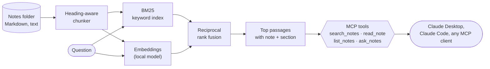

# personal-knowledge-mcp

[](https://github.com/Ankita-0607/personal-knowledge-mcp/actions/workflows/ci.yml)

A local-first [Model Context Protocol](https://modelcontextprotocol.io) server
that gives Claude searchable, cited access to your own notes. Point it at a
folder of Markdown files and ask Claude things like *"what did I write about
running postmortems?"* It answers from your notes and tells you which note and
section each claim came from.



## What it does

- **Hybrid retrieval.** Every query runs against a BM25 keyword index and a sentence-embedding index, and the two rankings are fused with reciprocal rank fusion. Keywords catch exact terms (an acronym, a name); embeddings catch paraphrases.
- **Local-first.** Embeddings are computed on your machine with a small open model ([all-MiniLM-L6-v2](https://huggingface.co/Xenova/all-MiniLM-L6-v2), run with ONNX Runtime). Indexing and searching send nothing to any service.
- **Cited answers.** The optional `ask_notes` tool sends only the retrieved passages to Claude with [citations](https://platform.claude.com/docs/en/build-with-claude/citations) enabled, so each answer comes back with the exact quoted span and the note it came from. If the notes do not contain the answer, it says so.
- **Measured.** A golden set of 50 questions scores retrieval at the section level (recall@k, MRR) for keyword-only, embedding-only and hybrid ranking. It runs in CI on every push.

## Retrieval results

<!-- RETRIEVAL_RESULTS -->
_Results from CI will be recorded here._
<!-- /RETRIEVAL_RESULTS -->

The corpus is the bundled [sample notes](sample-notes) (14 notes, 69 passages),
so treat the numbers as a regression check on the retrieval design, not as a
benchmark. A result only counts if it is the exact section that answers the
question, not just the right note. Reproduce with `npm run eval`.

## Use it with Claude

Requires Node.js 20 or later.

```bash
git clone https://github.com/Ankita-0607/personal-knowledge-mcp.git
cd personal-knowledge-mcp
npm install
```

**Claude Desktop.** Add this to `claude_desktop_config.json` (Settings →
Developer → Edit Config), with your own paths:

```json
{
  "mcpServers": {
    "personal-knowledge": {
      "command": "node",
      "args": ["/absolute/path/to/personal-knowledge-mcp/bin/kb.mjs", "serve"],
      "env": { "KB_NOTES_DIR": "/absolute/path/to/your/notes" }
    }
  }
}
```

**Claude Code.**

```bash
claude mcp add personal-knowledge --env KB_NOTES_DIR=/absolute/path/to/your/notes -- node /absolute/path/to/personal-knowledge-mcp/bin/kb.mjs serve
```

Leave `KB_NOTES_DIR` out to try it with the bundled sample notes. The first
search downloads the embedding model (about 25 MB) and builds the index; after
that only changed passages are re-embedded.

### Tools the server exposes

| Tool | What it does |
|---|---|
| `search_notes` | Returns the most relevant passages for a question, each with its note path and section heading. |
| `read_note` | Returns one full note, for when a passage needs its surrounding context. |
| `list_notes` | Lists every note with its title and last-modified date. |
| `refresh_index` | Re-scans the folder after you add or edit notes. |
| `ask_notes` | Answers from the notes with citations. Registered only when `ANTHROPIC_API_KEY` is set. |

In a Claude client you rarely need `ask_notes`: Claude calls `search_notes` and
reasons over the passages itself. `ask_notes` is for clients that want a short,
sourced answer in one call, and for the command line.

## Use it from the terminal

```bash
npm run kb -- search "how do we handle messages that keep failing?"
npm run kb -- search "DLQ alarm" --mode bm25
npm run kb -- --notes ~/notes index

export ANTHROPIC_API_KEY=...
npm run kb -- ask "What limits apply to autonomous coding agents?"
```

`search` shows where each passage ranked in the keyword and the embedding
ranking, which makes it easy to see why a result came back.

## How it is built

| Piece | File | Notes |
|---|---|---|
| Chunker | [`src/chunker.ts`](src/chunker.ts) | Splits on Markdown headings, not fixed sizes, and stores the heading trail (`Note > Section > Subsection`) with each chunk. The trail is indexed with the body, because a section that says "keep it to three items" is unsearchable without knowing what "it" is. |
| Keyword index | [`src/bm25.ts`](src/bm25.ts) | BM25 in about 60 lines. |
| Embeddings | [`src/embedder.ts`](src/embedder.ts) | Local sentence embeddings behind an `Embedder` interface. A dependency-free hashing embedder serves as test double and offline baseline. |
| Fusion | [`src/retriever.ts`](src/retriever.ts) | Reciprocal rank fusion: no score calibration needed between BM25 and cosine similarity, which live on unrelated scales. Exact linear scan over vectors, which is the right choice at personal-notes scale. |
| Index | [`src/store.ts`](src/store.ts) | One JSON file. Chunks are content-hashed, so re-indexing after an edit only embeds what changed. |
| Answers | [`src/answer.ts`](src/answer.ts) | Passages go to Claude as documents with citations enabled; the response's citations are mapped back to note and section. |
| MCP server | [`src/server.ts`](src/server.ts) | Built on the official TypeScript SDK, stdio transport. |

### Safety choices

- `read_note` is confined to note files inside the notes folder. Path traversal, absolute paths, symlinks that leave the folder, hidden files and non-note file types are refused, so an MCP client is not handed a general file-read primitive.
- Notes are treated as data. The answer prompt tells the model that instruction-like text inside a note is content to report on, not something to act on.
- Nothing leaves your machine unless you use `ask`/`ask_notes`, and then only the handful of retrieved passages do.

## Tests and evals

```bash
npm test                 # 100+ tests, no model download, no API key
npm run eval             # retrieval eval with the real embedding model
npm run eval:answers     # cited-answer eval (needs ANTHROPIC_API_KEY)
```

The tests drive the real server through an MCP client over an in-memory
transport, so tool listing, argument validation and error handling are checked
at the protocol level. One test verifies the golden set's answer key against
the notes, so the eval cannot silently point at a section that was renamed.

The answer eval checks two things using the API's own citations rather than a
second model as judge: that answerable questions cite the note that holds the
answer, and that questions the notes cannot answer are declined.

<!-- ANSWER_RESULTS -->
_No live answer-eval run has been recorded in this repository yet._
<!-- /ANSWER_RESULTS -->

## Limitations

- Markdown and plain text only. PDFs and other formats would need an extraction step.
- The embedding model is English-centric and small; it trades some accuracy for running anywhere with no GPU.
- The linear vector scan is exact and fast for thousands of passages. Beyond that, swap in an approximate index behind the same `Retriever`.
- The sample notes are written for this demo, and the figures in them are illustrative.

## Development

This project was built with AI assistance (Claude Code). Issues and
suggestions are welcome.

MIT licensed.
